# Game of Crowns

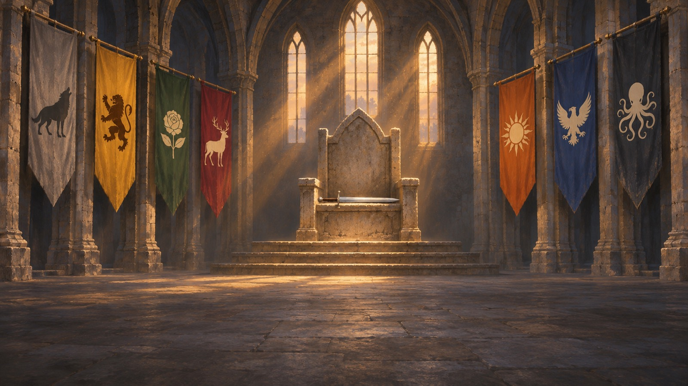

**Find out what kind of king you'd be.**

**[Download it free for your Mac](https://github.com/off-grid-ai/game-of-crowns/releases)** (Apple Silicon, nothing locked, no account) · **[Watch the 27-second trailer](https://github.com/off-grid-ai/game-of-crowns/releases/download/v0.4-20261106-bef6218/game-of-crowns-0.4-hook-16x9.mp4)**

You're the king, and seven great houses want your throne. All you've got to hold onto it is grain, gold and your word at court. Rule well and history calls you the Golden. Mess it up and you're the Bloody, or worse, the Deposed. It's free on any Apple Silicon Mac.

[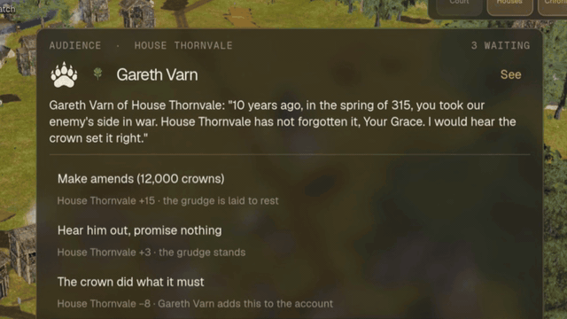](https://github.com/off-grid-ai/game-of-crowns/releases/download/v0.4-20261106-bef6218/game-of-crowns-0.4-hook-16x9.mp4)
*"10 years ago, in the spring of 315, you took our enemy's side in war." Make amends, hear him out, or tell him the crown did what it must. Click to watch.*

## Why you'll keep playing

- **Your choices come back for you.** Every house remembers what the crown did to it. Feed one through a famine and it answers your banners; snub its lord and he brings it up at court years later, with the year and the reason.
- **Every lord has a secret worth knowing.** All 83 lords, consorts, heirs and bannermen start with a past that matches everyone else's, from who refused whose daughter to who opened the gates at Windcross. Ten bannermen already have a reason to turn their coats, so find them before your enemies do.
- **No two reigns end the same way.** Pick the story that comes for your throne, like The Broken Oath, The Long Winter or The Crown's Debt, or let the realm choose. It plays out through the choices brought to your court, and you either hold the crown or lose it.
- **Watch the war, then step into it.** Zoom out and a painted map shows every town under whoever holds it, every host on the march and every siege. Click a town and you're on the ground watching the battle, the feast or your own rider on the road.
- **The lords talk back.** Run [Off Grid AI](https://getoffgridai.co/desktop) next to it and they plead, scheme and threaten you in their own words. It's free, it runs on your Mac, and nothing you say leaves it.
- **Make Aldmere yours.** Rename any house or person and rewrite anyone's story, memories, nature and loyalty right on their card. Do it from the menu and every reign you start after that begins your way.

## Seven houses, one throne

| | | | |
| --- | --- | --- | --- |
|  | 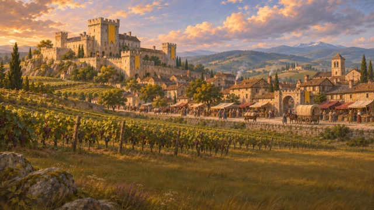 | 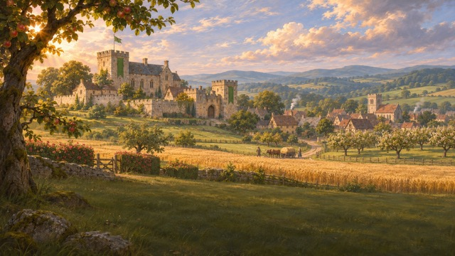 | 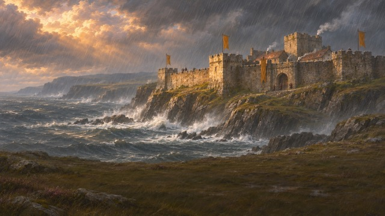 |
| **Wolfholt.** Honourable, proud, and they never forget. | **Goldcrest.** They buy what others must fight for. | **Thornvale.** The realm's breadbasket, and schemers who smile. | **Stormhold.** Fierce and loyal, until they aren't. |
| 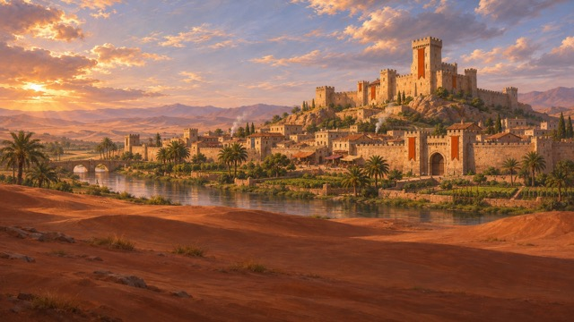 |  | 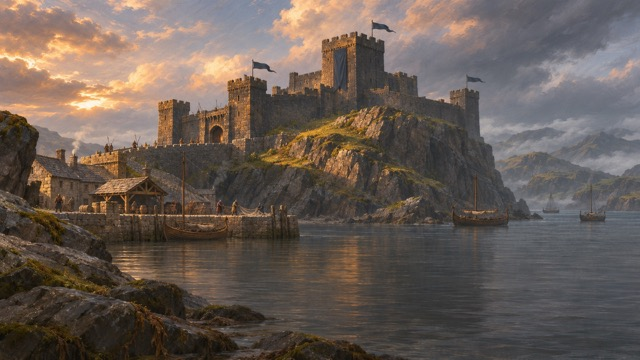 | 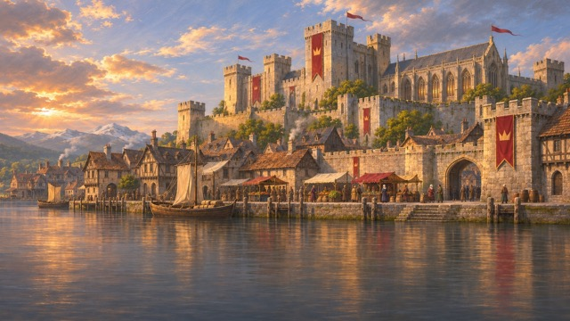 |
| **Sunspire.** The last to bend the knee. | **Highfell.** Untouchable in their mountains. | **Ironreach.** They take what they want from the coasts. | **The Crown.** Yours, as long as it stays strong. |

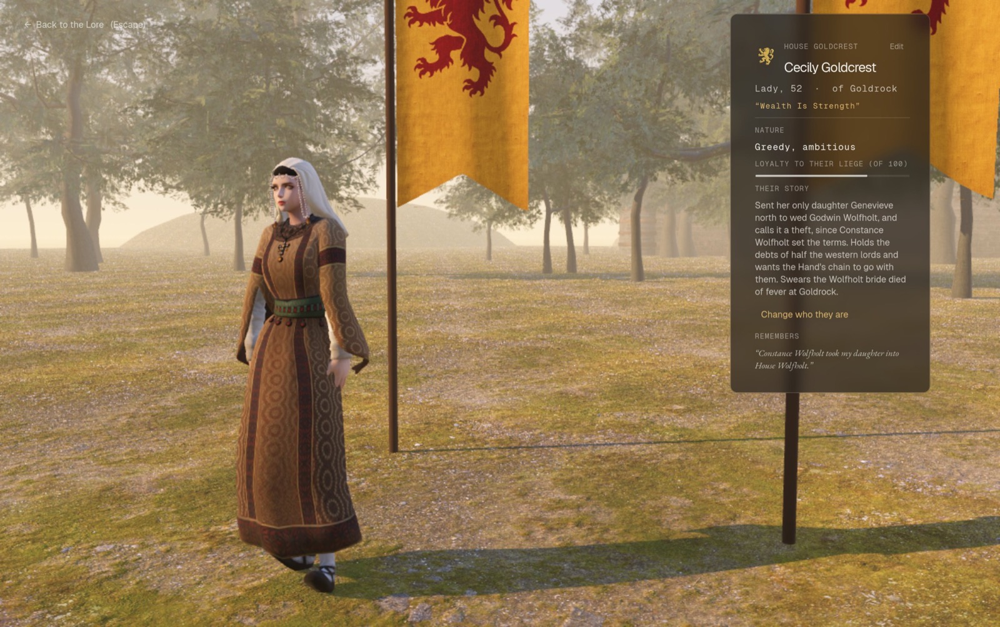
*Know what a lord is hiding before you sit across from them. Cecily Goldcrest holds the debts of half the western lords, and she swears the Wolfholt bride died of fever.*

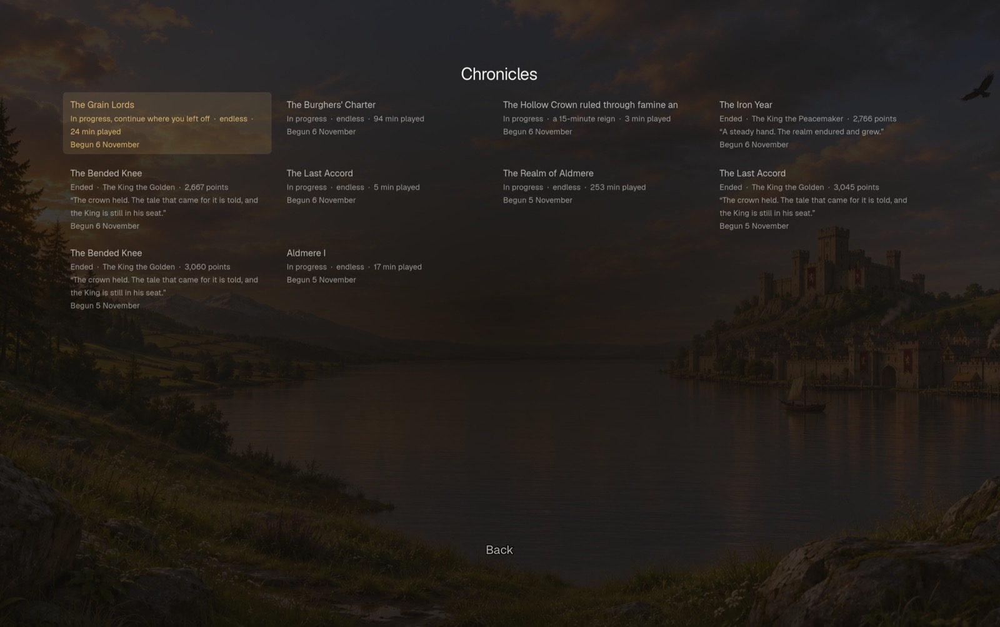
*Every reign you play is kept. Pick up the one in progress, or look back at how the realm remembers the ones that ended.*

**[Download Game of Crowns free](https://github.com/off-grid-ai/game-of-crowns/releases)** for any Mac with Apple Silicon. Windows is coming.

## Coming soon

Give a 👍 to the ones you want first, and the most wanted get built first. [See them all](https://github.com/off-grid-ai/game-of-crowns/issues?q=is%3Aissue+is%3Aopen+label%3Aroadmap+sort%3Areactions-%2B1-desc)

- [Multiplayer, with your friends as rival houses](https://github.com/off-grid-ai/game-of-crowns/issues/1)
- [Walk your realm in first person](https://github.com/off-grid-ai/game-of-crowns/issues/2)
- [Ride into battle in third person](https://github.com/off-grid-ai/game-of-crowns/issues/3)
- [Take control of anyone](https://github.com/off-grid-ai/game-of-crowns/issues/4)
- [Grow from commoner to king](https://github.com/off-grid-ai/game-of-crowns/issues/5)
- [Talk to anyone, and be remembered](https://github.com/off-grid-ai/game-of-crowns/issues/6)
- [Found a dynasty that outlives you](https://github.com/off-grid-ai/game-of-crowns/issues/7)
- [Rivals who plot for your throne](https://github.com/off-grid-ai/game-of-crowns/issues/8)
- [Nights lit by torch and fire](https://github.com/off-grid-ai/game-of-crowns/issues/9)
- [New continents to conquer](https://github.com/off-grid-ai/game-of-crowns/issues/10)
- [Magic and old blood](https://github.com/off-grid-ai/game-of-crowns/issues/11)
- [Lore that runs centuries deep](https://github.com/off-grid-ai/game-of-crowns/issues/12)
- [Bring your own maps](https://github.com/off-grid-ai/game-of-crowns/issues/13)
- [Bring your own characters](https://github.com/off-grid-ai/game-of-crowns/issues/14)
- [Write stories others can play](https://github.com/off-grid-ai/game-of-crowns/issues/15)
- [Play on Windows](https://github.com/off-grid-ai/game-of-crowns/issues/16)
- [Rule from your phone](https://github.com/off-grid-ai/game-of-crowns/issues/17)

## Releases

Every build is signed and notarised by Apple. [All releases](https://github.com/off-grid-ai/game-of-crowns/releases)

- **0.5.1**: every reign ends with the name history gives you, your score and the reign in numbers. Your Hand brings you a new crisis every year: plague, riots, a lord grown too strong, an heir to marry off. A house can have one royal favour a year, so gold can't buy everyone. Cards wait their turn instead of jumping in while you click.
- **0.5**: lords with written pasts and memories you can rewrite, full-length portraits of everyone at court, a painted map of the realm, and a new name for anyone you like.
- **0.4**: the first build we shared.

---

## For developers

Decisions live in [VISION.md](VISION.md) and [DESIGN.md](DESIGN.md), and the interface rules in [UI.md](UI.md). Write your own stories as data files: the game checks them and plays them against the live realm ([docs/STORY_ARCS.md](docs/STORY_ARCS.md)).

### Version 1

v1 is frozen (see "v1: what ships" in [VISION.md](VISION.md)). In v1 you are the King on the throne and rule from above: the realm, the court, decrees, the houses, the chronicle, and anyone you choose to see up close.

- It is always day. Nights, with lit windows and torches, come in v1.1.
- People talk among themselves as captions over their heads, not aloud.
- Walking the realm as the King or a lord (the streets, talking face to face, fighting, riding, going indoors) is built and kept in the code for version 2, switched off by one flag: `WALKING` in [`realm/scripts/features.gd`](realm/scripts/features.gd).

## How it fits together

```
 Freeciv server ──► bridge (Node) ──► realm (Godot 4.7)
  the simulation     turns, story,      what you see:
  (rules, AI,        characters,        land, towns, people,
   economy, war)     the court, model   scenes, the panels
```

- **Freeciv 3.2** runs the world: a custom medieval ruleset (`bridge/data/realmrules`), seven AI great houses (Goldcrest, Highfell, Ironreach, Stormhold, Sunspire, Thornvale, Wolfholt) plus the Crown at Kingsmere, on a hand-shaped continent. One turn is one season.
- **The bridge** (`bridge/server.js`, port 8787) starts Freeciv, reads every save and turn, and adds what Freeciv doesn't have: named characters with traits, goals and memories, the court and its petitions, the Hand's counsel, the King's decrees, story arcs, the stakes of the reign, and the chronicle. It serves the realm as JSON to the view.
- **The realm** (`realm/`, Godot 4.7, Forward+) draws it: Terrain3D land, Sky3D light, rivers and coast, towns built from realistic Sketchfab kits, townsfolk going about their day, armies and carts on the roads, and battles, sieges, feasts and the King's wagons as scenes you can watch.
- **Words** (a lord's petition in their own voice, people's talk, a ruling given in your own words) come from a small local model: Omni 2B, or Omni 1.7B, through the [Off Grid AI](https://github.com/off-grid-ai) desktop gateway (OpenAI-compatible, found on 127.0.0.1 from port 7878). Nothing ships with the game or is downloaded; without Off Grid AI, everything falls back to rules.

## Setup

1. Tools (Homebrew):
   ```bash
   brew install freeciv node
   brew install --cask godot
   ```
   Godot **4.7** (4.7.2 is what we build with), Freeciv **3.2**, a recent Node (the app bundles Node 26).
2. Art. Our own art (heraldry, logo, icons, sky, fonts, castle and town pieces, UI) is in the repo. Third-party art is not, by licence and by size; only its import settings and licence notes are tracked. Put it back in these folders before opening the game:

   | Folder in `realm/assets/` | What | Source |
   | --- | --- | --- |
   | `realistic/` | buildings, trees, props | Sketchfab (CC BY, credits in each folder's `license.txt`), Poly Haven (CC0) |
   | `people/` | townsfolk bodies, outfits, hair | Quaternius *Universal Base Characters* + *Fantasy Outfits* (CC0), Mixamo characters |
   | `anims/mixamo/` | every townsperson's move | Mixamo (Adobe account); list in [MIXAMO_DOWNLOADS.md](MIXAMO_DOWNLOADS.md) |
   | `hero/` | close-up characters and their moves | Sketchfab Mixamo-rigged characters + Mixamo |
   | `crops/`, `cavalry/`, `weapons/` | wheat, hay, cabbages; the horse; the lance | Sketchfab and Blend Swap, each with its `license.txt` |
   | `interiors/` | great hall, tavern, chapel, cottage (version 2) | Sketchfab, each with its `license.txt` |
   | `village/`, `props/`, `nature/`, `q/` | stylised kit pieces still in use | Quaternius MegaKits (CC0) |
   | `ground/` | ground and road textures | Poly Haven / ambientCG (CC0) |
   | `audio/` | music and sounds | listed one by one in [CREDITS.md](realm/assets/audio/CREDITS.md) |

   The file names each folder expects are the ones in its `.import` files. Asset hunting is briefed in `ASSET_SHORTLIST.md` and the `CODEX_*` briefs.
3. Open the project once so Godot imports everything (Apple Silicon: always native):
   ```bash
   arch -arm64 godot --headless --path realm --import
   ```
4. Optional: keep the realm alive whenever you're logged in.
   ```bash
   bridge/tools/install-launchagent.sh
   ```
5. Optional: the Off Grid AI desktop app with Omni 2B or 1.7B loaded, for people's own words, voices and spoken rulings.

## Running

```bash
./realm.sh
```

Wakes the bridge (which starts Freeciv) and opens the view. `./realm.sh status` prints the turn, towns and houses alive, `./realm.sh stop` saves and stops, `./realm.sh start` wakes it without the window. The world keeps running after you close the window, and catches up when you return.

A new realm starts from the title screen. **Begin a New Chronicle** lets you choose the world (Aldmere nine years in, Aldmere from year one, or a random realm), the length of the reign (endless, 30 minutes or an hour), the royal treasury and host, how many lords come to court, the language people speak to you in, the opening mood in your own words, and on the houses' side their temper, cunning, wealth and faith in the crown, plots, floods and famine, raiders, when the dead come, and whether a usurper may rise. Saved scenarios start you from a set you liked before.

The Mac app (`Game of Crowns.app`, one double-click, everything inside) is built by `packaging/build-mac.sh`; see [docs/SHIPPING.md](docs/SHIPPING.md).

## Playing

The aim of a reign: win every great house to the point where it would answer your banners (favour 35 and up), then end the wars between them (Peace above 50%). A house under 25 may rise against you; two such houses and one claims the throne.

- **Camera:** drag or WASD to pan (Shift faster), wheel to zoom, right-drag or Q/E and R/F to turn and tilt, **Z** back to Kingsmere, **M** hides the minimap. Leave the camera alone and it goes looking for whatever is happening in the realm.
- **Panels:** **K** the court, **H** the great houses, **C** the chronicle, **L** the ledger, **B** the Lore of Aldmere, **Space** pause, **Esc** close. Every key can be changed in Settings → Controls. Cmd + / − sizes the interface.
- **The top bar:** the season, the royal treasury and what it brings a season, Peace, the realm's souls, and the tithe, which you raise or lower in steps of 5%. A higher tithe fills the purse and cools every house.

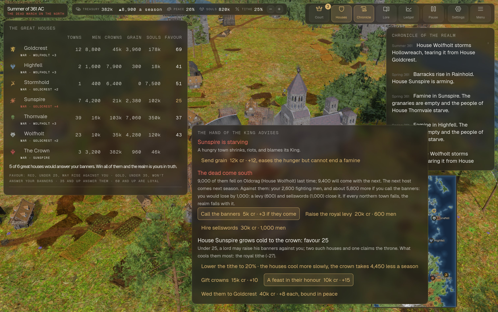
*The houses table with each house's favour, the Hand's counsel, and the chronicle.*

- **The Hand of the King** names the realm's most pressing matters, each with orders and their prices, his advice framed in gold: send grain to a starving town; against the dead, call the banners, raise the royal levy or hire sellswords; for a house growing cold, lower the tithe, gift crowns or hold a feast. For a war between two houses: command peace if both are warm enough to obey, or send a third, loyal house to keep the peace; back the weaker side with the King's gold; sit it out; or wed them to each other. A first reign's guide (answer a petitioner, follow one of his orders, call the banners) sits inside his card.
- **A house:** click it in the table for its treasury, souls, men and grain over time, its lord and bannermen, its wars and truces. "See" opens any of them up close: nature, loyalty, what they want, their story and what they remember. **Change who they are** rewrites them.

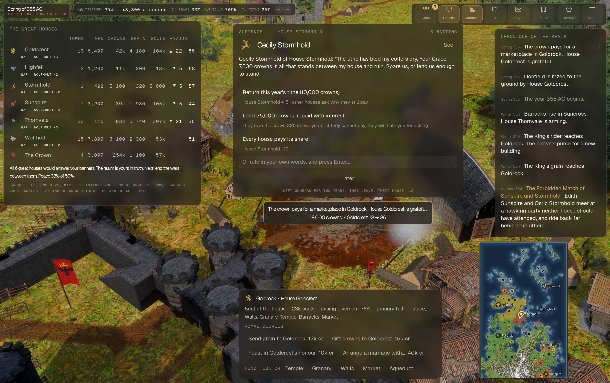
*An audience at court: pick a ruling, or give your own in your own words.*

- **The court:** most seasons a lord comes with a petition. Pick one of the rulings (each says what it does to each house's favour), type your own, or, with Off Grid AI running and Settings set to speak, say it aloud. A petitioner left unheard for two years goes home, and their house's favour falls.
- **A town:** click it for its people, stores and buildings, and the royal decrees: send grain, gift crowns to its lord, a feast in his honour, arrange a marriage, take a town that isn't a house's seat and grant it to another house, fund a building it hasn't built (temple, granary, walls, market, aqueduct). At Kingsmere: the royal levy, the banners and a feast at court. Every decree shows its price first.

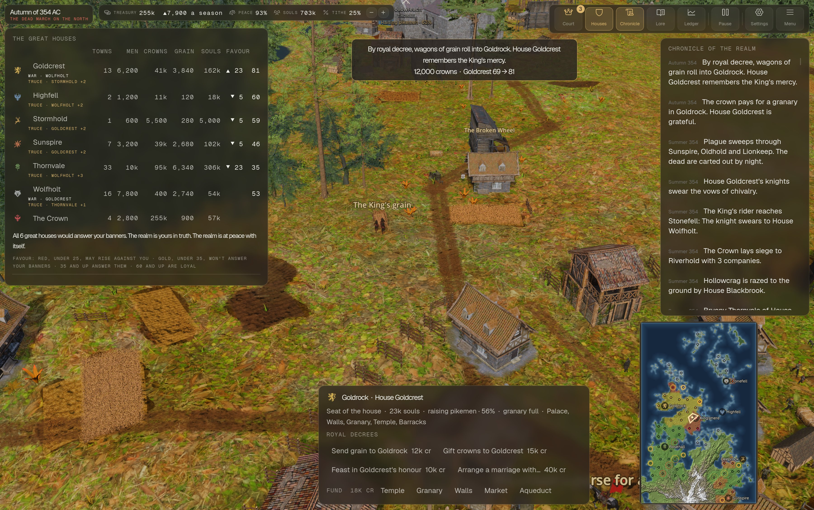
*The King's grain wagons on the road; the decree's effect on the house shows at the top.*

- **Watching:** when something worth seeing happens (a battle, a siege, a town burning, the King's grain or gold on the road), a line under the top bar offers to **Watch** it. Choose it and every panel steps aside while the scene plays; they come back as they were when it ends or you move.

## Repository

```
bridge/              the simulation bridge (Node, no dependencies)
  server.js          HTTP API, the Freeciv process, turns, scenes, the Hand's counsel
  app.js             the bridge as the packaged app runs it (bundled Freeciv)
  characters.js      the court: named people, goals, memories, petitions
  minds.js           every person a mind: mood, plans, bonds (docs/MINDS.md)
  townsfolk.js       commoners: name, trade, family, a past
  chatter.js         what people say to each other
  arcs.js            story arcs, one JSON file each in arcs/ (docs/STORY_ARCS.md)
  arcs-check.js      checks every arc file
  crown.js           treasury, tithe, favour, the King's decrees
  god.js             world conditions changed through Freeciv
  stakes.js          the calendar, usurpers, the dead, the end of a reign
  chronicles.js      start / switch / end realms; new-realm options
  narrator.js        Freeciv's events as chronicle lines; houses' and towns' names
  claude.js          the local model client (Off Grid AI gateway, Omni)
  lore.js            the Lore pages, read from WORLD.md
  rules.js           costs and granary sizes from the ruleset
  savefile.js        reads Freeciv's save files
  data/realmrules    the medieval Freeciv ruleset
  data/nation        the great houses' nations
  lua/               Freeciv-side scripts (world setup, events, snapshots)
  baseline/          a realm a few years in, where new Aldmere chronicles begin
  tools/             map generation (Azgaar), baseline capture, launch agent
realm/               the Godot project
  scripts/           everything you see (main.gd is the entry point)
  assets/retarget/   bone maps: Quaternius and Mixamo rigs -> Godot's humanoid
  tools/             renders, play scenarios, preview and asset helpers
  addons/            Terrain3D, Sky3D, Waterways, Boujie water shader
packaging/           build-mac.sh: the signed .app and .dmg
docs/                minds, story arcs, shipping, the play ledger and its frames
realm.sh             open / start / stop / status
*.md                 vision, design, world bible, UI, asset briefs
```

## Licence

Our code, docs and own art are [MIT](LICENSE). Freeciv is GPL 2.0 and runs as its own program. Third-party art keeps its own licence: each folder's `license.txt`, [audio credits](realm/assets/audio/CREDITS.md), the fonts' OFL files in `realm/assets/fonts/`, and the in-game Credits page, which lists everyone.

## Development notes

- **Run Godot natively.** A shell under Rosetta starts the universal Godot binary as Intel, several times slower. Use `arch -arm64 godot …` (`realm.sh` does).
- **Screenshots without playing:** `realm/tools/render.sh out.png --city=Stonefell --dist=5 --wait=60` (it waits its turn, so two renders never run at once), or by hand `arch -arm64 godot --path realm -- --shot=out.png --wait=60` plus a scene: `--city=<town> --dist=<n>`, `--new` (new chronicle screen), `--hero=<house id>` (a lord up close), `--move=<move>`, `--feast`, `--handover`, `--battle`, `--siege`, `--rider`. Version 2 scenes: `--control=<house id>`, `--interior=<great_hall|tavern|chapel|cottage>`. `--wait` must outlast the world's first build.
- **Playing it by script:** `--play=<scenario> --out=<dir>` feeds real keys and clicks from `realm/tools/play/*.play` and saves frames and a log; what each round found is in [docs/PLAY_LEDGER.md](docs/PLAY_LEDGER.md).
- **New Mixamo moves:** drop the FBX (Without Skin, 30 fps, In Place) into `realm/assets/anims/mixamo/` named for the move, import, and set its import to retarget with `res://assets/retarget/mixamo_map.tres` (copy the `_subresources` block from any neighbour's `.import`). It then plays on every townsperson.
- **Bone maps** are generated by `realm/tools/make_bone_maps.gd`.
- **The bridge** reloads on `launchctl kickstart -k gui/$(id -u)/com.realm.bridge` when installed as a launch agent.
