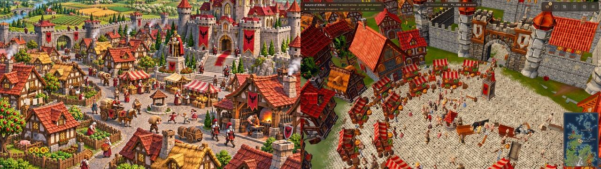
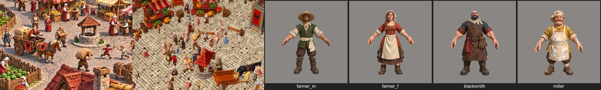
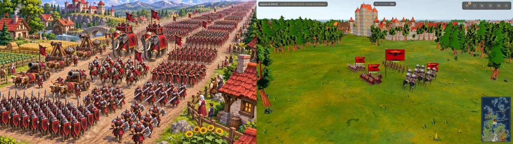
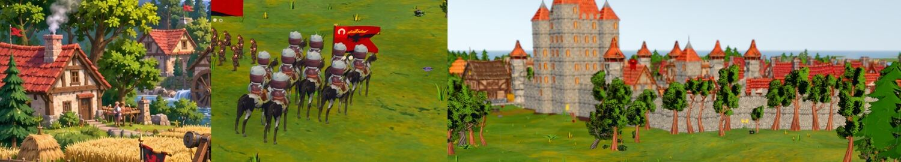
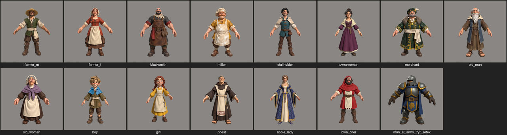

# Look audit: what is holding Game of Crowns back from the art target (2026-11-12)

Asked by Mac: "what is the bottleneck, what is actually holding us back?", "would it be better to use Tripo AI or
whatever?", "its some engine or some pack or something", "major issues with the trees, the grass and the overall
world", "not just looking aesthetically pleasing or good at the fidelity level that we decided". Read-only audit;
nothing in the game was changed. Target: [docs/art/target/](../art/target/) (01-town, 03-army). Casebook: the look.

## The answer in five lines

1. **It is not the engine, and it is not the generator.** Where the game draws a Meshy set made from one concept
   (the Kingsmere square), the frame matches 01-town on every measured number (contrast, saturation, colourfulness,
   sharpness: table below). Godot, Terrain3D, SDFGI, SSAO, AgX and the LUT are doing their job.
2. **The bottleneck: the game has no art set. It has about nine.** One frame shows Meshy buildings, KayKit chibi
   knights, a blendswap horse, Quaternius trees and houses, a watercolour ground pack, a Kenney-and-kit castle,
   Sketchfab and Poly Haven props, Mixamo bodies and image-gen banners. Each source has its own proportions, texel density, palette and painted light.
   Nothing makes them pass one style sheet and one scale sheet before they reach the game, so they never read as
   one family.
3. **The world between the buildings is sprinkled, not made.** The target's land is all land use: fields in rows,
   fences, orchards, gardens, roads with traffic, hedges, a river with a bridge. Ours is the Freeciv map stretched to
   true metres (a tile is about 33 m) and dusted with kit trees and grass tufts on a soft watercolour texture. That is
   Mac's "the trees, the grass and the overall world", and it is why the frame doesn't read as a lived-in realm even
   where each asset is fine.
4. **The fixes have gone into knobs, not inputs.** Mismatched sources get patched at run time: grass tinted x1.45,
   a red tree's leaves swapped for another texture, per-tree season tints, Meshy bodies narrowed to 0.86, tabards
   painted onto bodies, people scaled 1.5 then 1.1. Every knob holds one frame and breaks another. Hundreds of numbers
   in look.json, ground.json and assets.json are spent correcting inputs that should have been made right once.
5. **Process: for a day nobody judged a frame beside the target.** Each READY line was proven by a headless probe.
   A probe proves the thing works, not that it looks right, so chibi cavalry, Ottoman crescents and lollipop trees
   all shipped green.

**Recommendation: stay on Meshy (Tripo is about a 4% gain on a public vote board and would not make the assets
match). Make one art set to one style and scale sheet, replace every off-family source with it in one pass (units,
horses, trees, ground cover, castle), compose the land around towns as land use, and gate every visual change on a
frame judged beside the target.** The plan is at the end.

## The frames, side by side

All frames are from today's renders of the shared tree (supervisor milestone runs, 15:44 and 16:00, 1920x1080 and
3024x1728, `--look=one --trees=kit --ground=painted --castles=kit --houses=kit --landmarks=meshy ...`). No new GPU run
was queued: these are the current state at the target framings, and the one-Godot rule held.

**Town (01-town left, Kingsmere square right).** Closest to the target of anything in the game.

What's off, in order of harm:
- **People are specks.** In the same crop, the target's people are about 70 px tall, ours about 25 px. The Meshy
  cast is good (sheet below); it just can't be seen. The camera sits higher than 01-town's "roof height", and the
  cobbles are drawn at about 1 m a stone (estimate from the frame) (a stone is about two-thirds of a person), so the ground pattern swamps the
  crowd. The target's cobbles are about a sixth of a person.
- **Clothes are muddy on beige.** The target dresses its crowd in house red and white against grey stone, so every
  figure pops. Ours are browns and dusty pinks on warm beige cobbles.
- **The castle wall and gate are another style.** Grey kit blocks with orange cone roofs and a Meshy gatehouse. The
  target's walls are the same painted stone as its houses, with banners hung on them.
- **No land use beyond the square.** The target shows gardens, fences, orchards, fields and a river from the same
  camera; ours shows grass between plots.

*Left: 01-town crop. Middle: our square at the same crop. Right: our own Meshy cast in a turntable. The cast matches
the target. On screen it doesn't, because of scale, camera and contrast, not the model.*

**Army (03-army left, our muster right).** The furthest from the target.

*Left: 03-army's knights. Middle: our heavy cavalry. Right: Kingsmere's castle behind our trees.*

- **Mixed packs in one frame.** Meshy-style men-at-arms (painted, adult proportions) stand next to KayKit chibi
  riders (head about a third of body height, smooth plastic shading) on a realistic blendswap horse. Three art
  styles sit in one regiment row.
- **Trees are a third style.** Quaternius low-poly cards on thin orange-red trunks, set in a regular ring. The target
  draws dense painted canopies in clumps.
- **The ground is a soft green wash.** The watercolour pack's grass is a low-frequency smear (sharpness 27 against
  the target's 57). Grass tufts and flowers are lone Quaternius sprites with nothing between them.
- **The frame is 90% green and yellow.** In the target, 80% is red, orange and earth. An army frame should be a
  wall of house colour on a dirt road; ours is a few small blocks on a lawn.
- **Banners are too big and wrong.** Flags drawn in code, each about half the height of its unit, all carrying the
  crown's arms, with canton glyphs (one crescent reads Ottoman).
- **The castle is a fourth style.** A tall grey keep built in code from MegaKit walls and Kenney hexagon turrets,
  with orange cones: blocky, flat, and unlike the Meshy gatehouse set into it.

### Measured (realm/tools/look_gap.py, HUD masked)

| metric | 01-town | our square | 03-army | our muster |
|---|---|---|---|---|
| contrast (L std) | 20.6 | 21.8 | 20.2 | 15.9 |
| saturation mean | 0.51 | 0.52 | 0.47 | **0.81** |
| colourfulness | 28.5 | 28.0 | 27.3 | 30.2 |
| sharpness (Laplacian std) | 63.1 | 60.9 | 56.9 | **26.9** |
| red + orange share | 0.80 | 0.85 | 0.80 | **0.09** |
| green + yellow share | 0.19 | 0.12 | 0.15 | **0.90** |

The square matches the target's numbers. The renderer and grade are fine; the muster frame fails on content: an
over-saturated soft lawn with no house colour.

## Inventory: every visible asset by source

Ten sources reach the screen. Cells marked **off** break the family.

| Visible thing | Source (folder) | Albedo | Proportions / shading | Family? |
|---|---|---|---|---|
| Square set: townhouse, cottage, merchant, smithy, stall, well, statue, cart (`meshy/sq_*`) | Meshy 7.1 image-to-3D from Codex concepts | 2048 | Painted, chunky; house-colour mask | **yes, the reference** |
| Trades and farm buildings (`meshy/ts_*`, `fs_*`), tavern, gatehouse | Meshy API / Meshy community CC0 | 2048 | Painted | yes (community pieces vary) |
| Ordinary town houses, hall, church, inn (`village/`) | Quaternius Medieval Village MegaKit, painted webp swap | 2048 | Modular kit, cleaner and flatter than Meshy | near; off beside the square set |
| Royal castle and Kingsmere walls (`village/Wall_*`, `castle/tower-hexagon-*`) | MegaKit walls + **Kenney Castle Kit** turrets, built in code (`castle_builder.gd:27`) | 2048 / 512 | Blocky grey, orange cones | **off**: a third style, doesn't match the Meshy gatehouse on it |
| Townsfolk (`people/mixamo/cast_*`) | Meshy community cast, 1.8 m x 1.1 `readable`, slimmed x0.86 | 1024 (capped) | Painted, adult proportions | yes, but too small to read on screen |
| Crowd outfits (`people/*_Peasant`, `base/Superhero_*`) | Quaternius outfits on base bodies | 4096 | Smooth, low detail | **off** |
| Named/noble bodies (`people/mixamo/<name>`) | Mixamo characters | 1024-2048 | Realistic | **off** |
| Spearmen, men-at-arms, archers (`armies/meshy_*`) | Meshy, VAT-baked (`army_vat.gdshader`) | 2048 | Painted, realistic proportions | yes |
| Knights, engines (`armies/knight_v2`) | **KayKit Adventurers** (`army_visual.gd:10`) | 1024 | **Chibi, big head**, plastic shading | **off** |
| Cavalry (`armies/cavalry`) | KayKit rider on a blendswap horse, one VAT body | 2048x1024 | **Chibi rider on a realistic horse** | **off** |
| Road and field horses (`cavalry/horse`) | Blendswap "Horse Rigged All Gaits" | 2048 | Realistic, 38,942 tris | **off** |
| Cow, sheep, pig, goat, hen, dog (`meshy/beasts`) | Codex concepts → Meshy, Quaternius rigs | 2048 | Painted | yes |
| Trees: oaks, twisted trees, pines, bushes (`nature/`) | **Quaternius Stylized Nature** (`forest.gd:33`) | 1024 leaves | Low-poly cards, thin red trunks | **off** |
| Grass tufts, clover, flowers, rocks (`nature/`) | Quaternius | 512 | Sparse single sprites | **off** |
| Ground layers (`ground/painted`) | Voxel Core Lab "Hand-Painted Watercolor" CC0, Terrain3D | 2048 | Soft low-frequency wash, tinted x1.45 | **off**: too soft at our zoom |
| Roads, verges, fields, cobbles (`ground/*.jpg`) | Photo textures | 2048 | Photo detail; cobbles about 1 m a stone on screen | **off** |
| Carts, wagons, haystacks, fences, woodpiles (`realistic/`) | Sketchfab models | various | Realistic | **off** |
| Barrels, crates, buckets, lanterns (`realistic/ph`) | Poly Haven CC0 | 1024 | Photoreal | **off** |
| Benches, tables, bags, small banners (`props/`) | Quaternius | — | Low-poly | **off** |
| Siege engines (`castle/siege-*`) | Kenney Castle Kit (catapult and tower: Meshy) | 512 | Toy-like | **off** |
| Lamps, fountain, sails (`town/`) | Kenney Fantasy Town Kit | 512 colormap | Toy-like | **off** |
| House banners and sigils (`heraldry/`) | OpenAI image_gen, `banner_cloth`/`army_banner` shaders | 512x1024 | Flat; every regiment flies the crown's arms | **off** (L2) |
| Fire, smoke (`fx/fire`) | Kenney particles + GDQuest shader | 512 | Stylised | fits |

**Light and grade (one path for everything):** `main.gd:650-690` and `look.gd:80-135`: Sky3D, AgX (exposure 1.25,
white 8), LUT `assets/grade/v3b.png`, SSAO, SSIL, SDFGI, volumetric haze, a full-screen painted outline
(`outline.gdshader`). There is no per-asset painted shader; the painted look comes from texture swaps and `look.json`
`kit_tints`. One light can't make a photo barrel, a chibi knight and a watercolour lawn match: each brings its own
baked light and texel density.

**Side finding:** the render switches in the milestone command line (`--look=one --trees=kit --castles=kit
--landmarks=meshy ...`) are read by no script any more. What renders is set by `realm/data/*.json` (the v3 look, not
"one"). The switches suggest a choice that isn't being made.

## Why each claim holds (evidence)

- **Not the generator.** The Meshy square set (`docs/research/meshy-square-set.md`: codex concept → Meshy 7.1
  image-to-3D, multi-view, 2K texture, remesh) and the cast (`docs/research/meshy-cast.md`) clear the target in
  turntables and in the square frame. 
- **Not the renderer.** `realm/scripts/look.gd` already runs Sky3D, AgX with a fitted LUT, SDFGI bounce, SSAO and
  volumetric haze. The square frame matches 01-town on contrast, saturation and sharpness (table above).
- **Mixed packs.** `armies/knight_v2` (KayKit Adventurers, `army_visual.gd:11` "the knight every regiment of the kit
  wears"), `armies/cavalry` (licence_rider: KayKit; licence_horse: blendswap), `nature/` (Quaternius Stylized Nature,
  `data/assets.json` woods.kit), `ground/painted` (Voxel Core Lab watercolour, CC0), `realistic/` (Sketchfab carts,
  fences, haystacks) and `realistic/ph` (Poly Haven), `castle/` (Kenney Castle Kit turrets and siege engines),
  `village/` (Quaternius MegaKit houses and castle walls), `people/mixamo` (Mixamo bodies), `armies/meshy_*` and
  `meshy/*` (our Meshy sets). Full table above.
- **Knobs over inputs.** `data/ground.json` grass tint `[1.45, 1.32, 1.2]` over a watercolour texture;
  `data/assets.json` woods `leaf_texture` (a red-painted tree's leaves swapped) and seven per-model season tints;
  `data/people.json` `readable` 1.5 → 1.1, `slim_cast` 0.86 (Meshy bodies narrowed), procedural tabards and gold
  belts painted onto bodies. Counted: about 148 numbers in look.json, 45 in ground.json, 809 in assets.json.
- **World from the strategy map.** `realm/scripts/world_units.gd`: one game unit about 8.3 m, a Freeciv tile 4 units
  (about 33 m). The land between towns is Terrain3D's painted layers plus forest.gd's kit scatter. Nothing places
  fields, hedges, fences, orchards and paths as land use outside the town plots.
- **No frame judgement.** `docs/READY.md` "Look pass" (L1-L4) was written after Mac saw the frames. Each line it lists
  was passed by a probe.

## Generators, compared honestly

| Tool | Stylised low/mid poly | Keeping a set consistent | Rigging | Price (API) | Licence |
|---|---|---|---|---|---|
| **Meshy 7.1** (in use) | Low Poly mode; 2-8K textures, PBR or flat | Multi-image input (front + 3 views); **retexture from one style image**, keeping UVs | Humanoid strong, 500+ clips; quadrupeds weaker | ~30-35 credits a textured model; retexture 10, rig 5, clip 3 | Paid plans commercial |
| Tripo H3.1 / P1.0 | Smart low poly (500-20k tris or quads) | Multi-image; texture call takes a style image | Biped, **quadruped**, more; GLB/FBX | ~40-50 credits a model (~$0.40-0.50) | API use commercial |
| Rodin Gen-2 | Very dense (10M+), quads on Business plan | Part edits | No humanoid auto-rig found | ~$0.75 a generation | Paid |
| CSM Cube | Parts pipeline; little 2026 evidence | Parts | Not confirmed | Mid/top plans | Paid |
| Hunyuan3D 3.x | High detail, hosted only | — | — | 20 free a day | Open weights stop at 2.1: not licensed in EU, UK, South Korea; 1M MAU cap |
| TRELLIS.2 | 4B, PBR GLB to 4K, uneven texture | Image only | None (pair with UniRig) | Self-host, 24 GB GPU | MIT (two NVIDIA parts excepted) |

Sources: sloyd.ai AI 3D rankings (Tripo v3.1 1042 ELO, Meshy 6 1004, about 4% apart; none rate the hand-painted look);
docs.meshy.ai/api/retexture and /api/pricing (Meshy 7 generation stops 2026-12-31: move the scripts to 7.1/latest);
developers.tripo3d.com models/rig and docs/models-texture; Hunyuan3D-2 LICENSE on Hugging Face;
comfyui-wiki TRELLIS.2 note (2025-12-18). The most common defect across all of them is light baked into the albedo;
mixed sources each bake their own light, which is one more reason mixed packs never match.

**Recommendation: stay on Meshy.** Switching to Tripo changes nothing about the family problem: it has the same kind
of style-image texture call and is a few points apart on quality votes. The win is in the inputs: one concept sheet
per asset from the one style prompt, Meshy multi-image to 3D, then every asset (including any community or kit piece
we keep) retextured from the **same** style image. **One test is worth doing on Tripo: rig one horse** (it lists a
quadruped rig type) against Meshy's, since horses are Meshy's weak spot and cavalry is the worst offender.

## The fix plan (smallest set, in order)

1. **Write the style and scale sheet (half a day, no code).** One page beside docs/art/target: the style prompt, one
   style image for retexture, head-to-body ratios (adults about 1:5, chunky, no chibi), texel density, the palette
   (house colour on cloth, roofs and banners; natural stone and timber; no brown companies), and the world scale
   (people about 1.3x life against buildings, cobbles a sixth of a person, trees one to one and a half houses tall).
   Every asset must pass it before it is wired in.
2. **Replace the off-family units in one pass.** Knights, cavalry riders and horses, archers and engines from the
   Meshy cast pipeline (concept → multi-image → retexture → rig), test-rigging one horse on Tripo first. KayKit
   `knight_v2` and `armies/cavalry` go in the same change (no fallbacks, per CLAUDE.md).
3. **Replace trees and ground cover.** A Meshy painted broadleaf and pine set (three or four of each, clumps) drawn
   from 01-town and 03-army crops, plus painted grass clumps, flower beds and bushes. The Quaternius trees and tufts go.
   Swap the watercolour grass for a sharper hand-painted ground with visible blades and patches, drawn at the
   people's scale.
4. **One castle, wall and prop set in the house style.** Castle keep, wall stretch and towers from 01-town's
   castle, made in Meshy to match the gatehouse it already has; the Kenney turrets go. Carts, barrels, crates,
   fences and haystacks from the same pipeline replace the Sketchfab, Poly Haven, Quaternius and Kenney props.
   The MegaKit houses get retextured from the one style image, or replaced by square-set variants.
5. **Compose the land around towns as land use.** Fields in rows, fences and hedges, orchards, gardens, roads with
   verges and traffic, out to the edge of each town's view. That is the world Mac sees missing; it is mostly placement
   of assets we will already have.
6. **Fix the town camera and contrast.** Bring the town view down to 01-town's roof height, scale the cobbles to the
   sheet, dress the crowd in house colours and whites. Then strip the knobs the new inputs make pointless (grass
   tint, leaf swap, slim_cast, people readable), in the same change.
7. **Banners.** Each house's own arms on banner and shield, banners sized to the regiment as in 03-army, no crescent
   (READY L2).

**Process gate (from now on):** no visual change counts as done until Claude has judged a frame beside the matching
target image at the same framing, listed what's off first, and attached the side-by-side to the commit or report.
A probe proves it works; only the side-by-side proves it looks right. One owner holds "the frame" for each target
image, not one owner per system.
